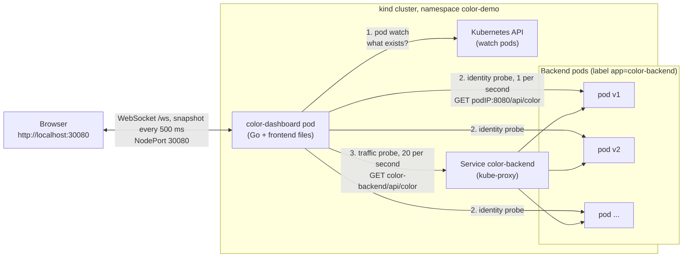
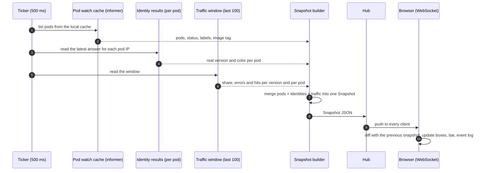

# Architecture

This page explains how the dashboard knows what to draw. It has seven parts:

1. [The big picture](#1-the-big-picture)
2. [One 500 ms tick](#2-one-500-ms-tick)
3. [The three data sources](#3-the-three-data-sources)
4. [Why keep-alive is disabled](#4-why-keep-alive-is-disabled)
5. [Why the traffic bar lags about 5 seconds](#5-why-the-traffic-bar-lags-about-5-seconds)
6. [The Snapshot JSON contract](#6-the-snapshot-json-contract)
7. [How this maps to the ALB phase](#7-how-this-maps-to-the-alb-phase)

## 1. The big picture
The dashboard is one Go pod inside the cluster. It talks to the Kubernetes API, to the Service `color-backend`, and directly to every backend pod. It pushes the result to the browser over a WebSocket.



## 2. One 500 ms tick
Every 500 ms the dashboard builds one snapshot and sends it to every connected browser. The probes run on their own timers and only update shared in-memory state.



The pod list comes from a local cache that the Kubernetes watch keeps up to date, so a tick does not call the API server. The latest snapshot is also available as plain JSON at `GET /api/state`; the end-to-end test (`scripts/e2e.sh`) reads it.

## 3. The three data sources
Each source answers a different question. They can disagree, and that is useful for teaching.

| Source | How it works | What it proves | Example of a disagreement |
|---|---|---|---|
| **Pod watch** | A shared informer watches pods with the label `app=color-backend` through the Kubernetes API (the dashboard has a read-only Role: get, list, watch on pods) | **What exists.** Which pods there are, their node, age, and state: Pending, Starting, Ready, Terminating, Failed. Version comes from the image tag. | A pod is Running but not Ready: the box has stripes. |
| **Identity probe** | Once per second, `GET http://<podIP>:8080/api/color` for every pod that has an IP | **What each pod is.** The real version and color the pod answers with. This also teaches the dashboard which color belongs to which version. | The image tag says v2, but the pod answers something else. (The answer wins.) |
| **Traffic probe** | 20 requests per second to `TARGET_URL` (default `http://color-backend/api/color`), results kept in a ring buffer of the last 100 | **What users get.** Which version answered, how many requests failed, and how many hits each pod got. | A pod is Ready but gets 0 hits (dimmed "no traffic" badge), or all pods look healthy but the answer is "unreachable". |

The pod watch alone cannot show errors or traffic. The traffic probe alone cannot show pods that receive nothing. Together they give the full picture.

Version `"unreachable"` in the traffic data means the request got no answer from any pod (connection failure).

## 4. Why keep-alive is disabled
A Kubernetes Service is not a process that receives requests. It is a set of rules that `kube-proxy` writes on every node. These rules choose a pod **when a new TCP connection is opened**. All requests on the same connection go to the same pod.

If the traffic probe used HTTP keep-alive, it would open one connection and reuse it. Then:

- every request would reach the same pod,
- the traffic bar would show 100% for one version even when 4 pods of another version are Ready,
- a Blue/Green switch or a canary at 30% would look wrong or very late.

So the probe disables keep-alive. Every request opens a new connection, and kube-proxy makes a fresh choice every time. This is also how many real clients behave (many short connections). You can see the difference yourself in [Lecture 0](lectures/00-setup-and-tour.md): six `curl` processes reach different pods, while one `curl` with six URLs reuses one connection and reaches one pod.

## 5. Why the traffic bar lags about 5 seconds
The bar is calculated from the **last 100 requests**. The probe sends **20 requests per second**.

```
window = 100 requests / 20 requests per second = 5 seconds
```

When something changes (for example a Blue/Green switch), the old requests stay in the window until 100 new ones push them out. So the bar needs about 5 seconds to show the new state, and during that time it shows a mix. This is normal. It also means failed requests stay visible for about 5 seconds after the problem is gone.

You can change this with two environment variables of the dashboard Deployment (in `k8s/base/20-dashboard.yaml`):

| Variable | Default | Effect |
|---|---|---|
| `PROBE_RPS` | `20` | Requests per second sent through the Service |
| `WINDOW_SIZE` | `100` | How many recent requests the bar counts |

The lag is `WINDOW_SIZE / PROBE_RPS` seconds. For example, `WINDOW_SIZE=20` gives 1 second: faster but jumpier. Change it with:

```bash
kubectl --context kind-deploy-demo -n color-demo set env deploy/color-dashboard WINDOW_SIZE=20
```

## 6. The Snapshot JSON contract
The dashboard sends this JSON to the browser every 500 ms (WebSocket `/ws`), and also serves the latest one at `GET /api/state`.

```json
{
  "namespace": "color-demo",
  "target": "http://color-backend/api/color",
  "time": "2026-11-25T12:00:00Z",
  "pods": [{"name":"color-backend-6f7c9-x2k","node":"deploy-demo-worker","ip":"10.244.1.5",
            "version":"v1","color":"royalblue","status":"Ready",
            "labels":{"app":"color-backend"},"hits":17,"errors":0,"ageSeconds":42}],
  "traffic": {"total":100,"errors":0,
              "byVersion":[{"version":"v1","color":"royalblue","count":100,"errors":0,"percent":100}]}
}
```

Rules of the contract:

- Arrays and maps are never `null` (an empty list is `[]`, empty labels are `{}`).
- `pods[].status` is one of `Pending`, `Starting`, `Ready`, `Terminating`, `Failed`.
- `pods[].hits` and `pods[].errors` count requests of the traffic window that reached this pod.
- `traffic.byVersion[].percent` is the share of the window. Connection failures are counted under the version `"unreachable"`.
- `target` is the URL the traffic probe calls. It is shown in the page header.

## 7. How this maps to the ALB phase
In phase 2 the project moves to a `kubeadm` cluster on AWS with an Application Load Balancer (see [Lecture 5](lectures/05-next-kubeadm-alb.md)).

The dashboard needs **one change**: set `TARGET_URL` to the ALB DNS name.

```
Phase 1:  TARGET_URL = http://color-backend/api/color             (Service, kube-proxy)
Phase 2:  TARGET_URL = http://<alb-dns-name>/api/color            (ALB, weighted target groups)
```

What changes and what stays the same:

| Part | Phase 1 (kind) | Phase 2 (ALB) |
|---|---|---|
| Pod watch | unchanged | unchanged |
| Identity probe | unchanged | unchanged |
| Traffic probe goes to | the Service `color-backend` | the ALB DNS name |
| Who splits the traffic | kube-proxy, evenly over Ready pods (share = replica ratio) | the ALB, by target group weight (share = weight) |
| What the traffic bar shows | replica ratios | **ALB weights**, for example 90 / 10 with only 1 pod per version |
| Keep-alive disabled | needed for kube-proxy | still useful: every request is a fresh routing decision |

The dashboard must be able to reach the ALB DNS name from where it runs. All boxes and states keep working exactly as before, because they come from the pod watch and the identity probe, which do not depend on the traffic path.
